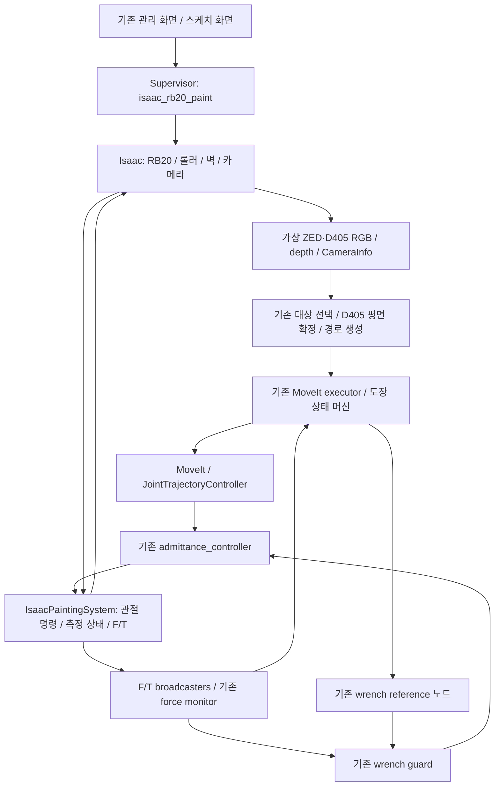

# RB20 롤러 도장 시스템의 Isaac Sim 이식 설계

작성일: 2026-10-13

기준 저장소: `minjeasung/sketch-robot-runtime`

작업 위치: `/home/minjea/robotics/sketch-robot-runtime-main`

검토한 코드: `codex/construct-isaac-sim`, `ed63753fd5e1b160dbb24c63e30ad725f7b6a68f`

상태: 사용자가 RB20+롤러와 설계 진행을 승인함. 이 문서는 상세 설계 검토본이며 구현·시운전 완료 보고서가 아니다.

## 1. 목적과 완료 조건

기존 실로봇 도장 시스템을 현재 작업 폴더의 Isaac Sim 환경으로 옮긴다. 사용자는 **RB20-1900ES + 기존 롤러 EOAT**를 선택했다. 기존 관리 화면과 스케치 화면에서 대상을 고르고, 카메라로 작업 평면을 측정하고, 경로를 생성·검증한 뒤, 시뮬레이션 로봇이 실제 접촉 반력을 받으며 도장 획을 실행하게 한다.

재사용 대상은 UI뿐 아니라 D405 평면 확정, 경로 식별자·해시, MoveIt 계획, FollowJointTrajectory 실행, 영점 보정, 접촉 탐색, 가압·도장·감압·후퇴, 어드미턴스 제어와 중단 처리다. Isaac 장면에서 관절이 움직이고 **측정 접촉력이 제어기로 돌아오는 폐루프**까지 확인해야 이식 완료로 판정한다.

물리 접촉과 궤적 실행을 재현한다. 페인트 유체·도막 두께·롤러 섬유 변형, 실제 RB20 제어기의 내부 서보 특성이나 실장비 성능 인증은 이번 범위에 포함하지 않는다. 현재 URDF의 롤러는 고정 조인트이므로 수동 회전축을 새로 추가하는 것도 별도 작업이다.

## 2. 현재 코드에서 확인한 재사용점과 누락점

| 영역 | 확인한 상태 | 설계 결정 |
|---|---|---|
| RB20 형상 | `robot_models.py`, `rb20_sketch_arm.xacro`에 모델·관절 제한·공통 TCP 정의가 있음 | 번들 모델과 EOAT를 단일 형상 원본으로 사용 |
| 도장 실행 | `moveit_executor.py`, `painting_execution.py`, `rbpodo_painting_control`에 기존 상태 머신과 힘 감시가 있음 | 공통 실행 코드를 유지하고 장비 경계만 연결 |
| 하드웨어 선택 | `rb_6dof.ros2_control.xacro`는 항상 `RBPodoHardwareInterface`를 로드함. `use_isaac_sim`이 이 매크로의 선택 인자가 아님 | 기존 플래그만 켜는 방법을 사용하지 않고 전용 시뮬레이션 플러그인 선택을 명시 |
| fake 모드 | 실로봇 플러그인의 주석상 `fake_sensor_commands=false`이면 fake 관절 모드에서도 실장비 F/T 통신을 시도할 수 있음 | 시뮬레이션에서 실로봇 플러그인을 로드하지 않음 |
| 이전 Isaac RB10 | `isaac_sim_rb10.py`는 RB10 경로·장면·루트 90도 회전이 고정됨 | RB20 전용 장면을 추가하고 RB10 장면을 수정해 억지로 공용화하지 않음 |
| MoveIt 좌표 | `rb10_moveit_full.launch.py`는 Isaac일 때 `world → link0`에 90도 회전을 넣음 | 새 RB20 프로파일은 `world = link0`로 명시하고 해당 보정을 적용하지 않음 |
| 카메라 | `rb10_perception_sketch.launch.py`와 `depth_to_pointcloud_node.py`에 가상 ZED/D405 ROS 입력 경로가 있음 | 기존 perception 노드를 유지하고 Isaac RGB·깊이·내부 파라미터를 공급 |
| 관리 기능 | `process_supervisor.py`에 Construct 전용 Isaac 프로파일이 있고 paint는 거부함 | 별도 `isaac_rb20_paint` 프로파일 추가 |
| Construct 관절 브리지 | 고정한 `topic_based_ros2_control` 버전은 JointState 입출력을 구현함 | 도장에 필요한 F/T state interface·tare·freshness 계약은 전용 플러그인에 구현 |
| 시계 전달 | 최상위 도장 launch는 `use_sim_time`을 모든 perception·힘 제어 노드에 일괄 전달하지 않음 | 관련 노드와 컨트롤러에 일관되게 전달하고 watchdog 시계는 별도로 유지 |

현재 숫자는 오래된 보고서가 아니라 `painting_system_real.yaml`의 유효 설정을 기준으로 삼는다. 예를 들어 현재 기본 접촉력은 20 N이고, normal force hold 범위는 20–30 N이다. 파일의 과거 실험 주석에 다른 값이 있으므로 주석에서 실행값을 추출하지 않는다.

## 3. 접근 방식과 선택

| 방식 | 장점 | 제약 | 선택 |
|---|---|---|---|
| 기존 도장 런타임 + Isaac 장비 어댑터 | 원본 실행·힘 제어·UI를 함께 검증할 수 있음 | 관절·F/T·tare를 연결하는 작업 필요 | 채택 |
| 기존 RB10 Isaac 스크립트의 모델만 교체 | 장면을 빠르게 띄울 수 있음 | 하드코딩된 좌표와 경로, 도장용 피드백 계약을 해결하지 못함 | 사용하지 않음 |
| 별도 도장 데모와 독립 제어기 작성 | 데모 구현이 독립적임 | 원본 런타임의 동작 검증이 되지 않음 | 사용하지 않음 |

새 기능은 하나의 RB20 도장 시뮬레이션 프로파일로 제공한다. 기존 실장비 paint/spray 및 Construct spray/weld의 기본값·서비스 실행 방식은 그대로 유지한다.

## 4. 전체 구조

도장 상태 머신이 만드는 명목 경로와 어드미턴스가 보정한 관절 명령을 동일한 Isaac articulation에 전달한다. executor가 `/isaac_joint_command`에 직접 명령을 보내 컨트롤러를 우회하는 구형 실행 방식은 새 프로파일에서 허용하지 않는다.

## 5. 로봇·공구·작업벽과 좌표

### 단일 모델 원본

`rbpodo_with_eoat.urdf.xacro`를 `model_id=rb20_1900es`로 확장한 기계 모델을 사용한다. 준비 스크립트가 기존 `<ros2_control>` 블록을 **생성 파일 안에서만** 전용 시뮬레이션 하드웨어 선언으로 교체한다. 같은 결과를 MoveIt·robot_state_publisher와 USD 생성에 사용한다. 관절 이름·축·제한·TCP·EOAT 변환이 원본과 일치하는지 비교하고 manifest에 입력 파일 해시를 남긴다.

제어 관절은 `base`, `shoulder`, `elbow`, `wrist1`, `wrist2`, `wrist3`다. 계획 그룹은 `manipulator`, 끝단은 `tcp`, 기준은 `link0`다. `world → link0`는 항등 변환으로 고정한다. RB10의 과거 90도 보정이나 학습된 ready/view/calib 자세를 가져오지 않는다.

TCP +Y는 표면의 외측 법선, TCP −Y는 가압 방향이다. 번들 RB20의 플랜지와 공통 TCP 회전 관계를 유지한다. 롤러 길이 0.175 m, 반지름 0.026 m, TCP에서 롤러 외측 접촉점까지의 명목 법선 거리 0.27020 m를 형상 검증 기준으로 사용한다.

### 장면과 충돌

장면 설정 한 파일에서 베이스·바닥·작업벽·고정 ZED 배치와 로봇 시작 자세를 정의한다. 최초 구현 단계에서 RB20 FK/IK·충돌 검사·카메라 가시성을 확인해 시작 자세와 벽 위치를 확정하고 버전 관리한다. 실행 중 도달성을 맞추려고 벽이나 로봇을 자동 이동하지 않는다.

Isaac과 MoveIt은 같은 벽 위치·크기를 사용한다. 기존 롤러 전용 접촉 collision link와 브래킷·센서 충돌 형상을 구분한다. 접촉 상태에서 롤러와 해당 작업면 사이의 MoveIt 충돌 허용만 기존 로직으로 전환한다. Isaac의 롤러–벽 물리 충돌은 계속 활성화하여 반력을 계산한다.

USD importer는 F/T 측정에 필요한 고정 조인트를 보존한다. 질량 없는 좌표 프레임이나 fixed-link 처리 때문에 해당 조인트의 측정값을 얻지 못하면 asset 준비를 실패시킨다. 필요한 관성 재배분은 생성 자산의 변경으로 기록하고, 총 질량·질량중심·관성과 TCP/카메라 형상을 보존해 검증한다. 임의 질량을 더해 센서 문제를 숨기지 않는다.

## 6. 관절·힘센서 시뮬레이션 어댑터

### ros2_control 경계

신규 `src/isaac_painting_hardware` 패키지의 `IsaacPaintingSystem`이 6개 관절 position command와 position/velocity/effort state, `ft_sensor` 및 `ft_sensor_raw`의 6축 state interface를 제공한다. 이 패키지는 로봇 IP나 RBPodo 장비 통신 객체를 사용하지 않는다.

Isaac 피드백이 오기 전에는 명령을 상태로 복사하지 않는다. 측정이 없거나 오래되면 센서는 invalid로 표시하고 새 운동 명령을 차단한다. controller_manager는 기존 JTC → admittance 체인을 사용하고, `/joint_states`와 F/T 공개 토픽은 각 broadcaster가 단독 발행한다. Isaac은 별도의 내부 상태 토픽만 발행한다.

내부 통신은 작은 신규 `isaac_painting_msgs` 패키지로 계약을 정의한다. 단일 상태 메시지에 `session_id`, `scene_revision`, `step_index`, simulation stamp, 6개 관절의 이름·위치·속도·노력, `ft_link`의 raw wrench, 각 입력의 validity 및 pause/reset 상태를 묶는다. 명령에는 동일 session/revision, sequence, 생성 시각, 관절 position target과 enable 상태를 넣는다. 이전 세션·역행한 step·중복 명령·누락 관절·비유한 숫자를 거부한다.

상태 토픽은 `/isaac/rb20_painting/state`, 명령 토픽은 `/isaac/rb20_painting/command`로 고정한다. 둘 다 과거 명령을 재생하지 않는 volatile QoS와 작은 큐를 사용한다. 장비의 `session_id`는 실행마다 새로 생성하고, 관리 프로세스가 기대하는 session과 대조한다. 토픽 이름만 같은 다른 시뮬레이터에 자동 연결하지 않는다.

### 실제 물리 반력

F/T는 Isaac articulation의 고정 조인트 반력을 읽는다. 목표 접촉력, 궤적 진행률 또는 `PAINT` 상태를 측정값으로 되돌려 보내지 않는다. 센서 경계는 `ft_sensor_joint`의 하류 전체 EOAT 하중을 포함해야 한다. `aft200_fixed_joint`만 읽으면 현 URDF에서 형제 링크인 롤러 조립체 하중을 빠뜨릴 수 있으므로 측정 경계를 asset 검사에서 확인한다.

설치된 Isaac 6.1의 호환 API에 `get_measured_joint_forces`가 있으며, 반환값은 child body 기준의 incoming joint wrench다. 조인트 이름으로 측정 대상을 찾고 숫자 인덱스에 의존하지 않는 어댑터로 감싼다. 원점 이동에 따른 `r × F` 토크를 포함해 `ft_link`로 변환한다. 이 API의 고정 조인트 F/T 용도는 [NVIDIA articulation sensor 문서](https://docs.isaacsim.omniverse.nvidia.com/5.1.0/sensors/isaacsim_sensors_physics_articulation_force.html)에도 설명되어 있으며, 실제 사용 가능 여부는 설치된 6.1과 생성 USD로 검증한다.

원래 측정값에는 공구 중력과 관성 하중이 포함될 수 있다. 진단 로그에는 보정 전 값을 남기고, 시뮬레이션 URDF의 하류 질량·질량중심으로 중력 항을 계산해 한 번만 보정한다. 기존 controller의 중력 보정은 이 프로파일에서 0으로 설정해 중복 보정을 방지한다. `ft_sensor_raw`는 중력·tare 보정 이후, deadband·필터·clamp 이전 값이며 기존 계약을 따른다. 동적 하중을 임의로 삭제하지 않는다.

시뮬레이션 어댑터는 기존 `/rbpodo_ft_tare/runtime_free_space_tare`의 `std_srvs/Trigger` 계약을 제공한다. 자유 공간·정지·force off·compliance off·새 측정값·샘플 분산 조건을 실제 입력으로 검사한 후 tare를 완료한다. 별도의 controller fault, motion inhibit 및 시뮬레이션 상태 진단을 제공하되 실제 RBPodo SystemState를 정상값으로 위조하지 않는다.

### 접촉 물성과 제어 설정

초기 controller update는 기존과 같은 100 Hz, 물리 적분은 500 Hz를 목표로 한다. RGB·depth 렌더링은 기본 15 Hz로 분리한다. 값은 프로파일에 기록하고 실제 달성 주기·실시간 배율을 측정한다. 목표 주기를 달성하지 못하면 통과로 기록하지 않으며 물리·렌더 비용을 먼저 조정한다.

첫 시험은 비접촉 이동과 정지 가압으로 센서 부호·중력 보정·접촉 안정성을 검증한다. 이후 기존 기본값 20 N과 20–30 N hold band로 다중 획을 검증한다. 초기 저하중 시험은 목표 힘뿐 아니라 접촉 판정·hold band·해당 안전 한도를 일관되게 정의한 시험 전용 설정으로 수행한다.

관절 drive·충돌 재질·solver 설정은 시뮬레이션 전용 파일에 둔다. 기존 실장비 튜닝을 덮어쓰지 않는다. 진동이나 과력을 감추기 위해 측정값을 목표값에 맞추거나 힘 감시를 끄지 않는다. 물성은 시험 모델이며 실물 롤러의 보정된 물성으로 표시하지 않는다.

## 7. 가상 ZED/D405와 기존 인지 흐름

첫 버전은 Isaac ROS 카메라 발행기를 사용해 **기존 native ROS 토픽 입력**에 연결한다. 관리 UI와 인지 알고리즘은 유지하되 실제 ZED SDK·RealSense·Outpost 장비 연결은 필요하지 않다. Construct의 공식 Outpost 스트림 경로는 변경하지 않는다.

ZED는 고정 시점의 RGB·depth·CameraInfo를 발행하고, D405는 URDF의 롤러 EOAT에 장착된 시점에서 발행한다. 카메라 pose·내부 파라미터·optical 축·depth 단위를 렌더링과 ROS 양쪽에서 일치시킨다. RGB와 depth는 같은 투영 모델로 등록하며 실제 카메라의 노이즈·스테레오 오차 재현은 완료 조건에서 제외한다. Isaac의 [ROS 카메라 발행 기능](https://docs.isaacsim.omniverse.nvidia.com/latest/ros2_tutorials/advanced_sensors/tutorial_ros2_camera_publishing.html)을 사용하되 실제 발행 설정은 설치된 6.1 API로 확인한다.

| 입력 | 기존 연결 |
|---|---|
| ZED RGB·CameraInfo | 기존 웹 영상과 target selector가 구독하는 토픽으로 remap |
| ZED depth | `/zed/zed_node/depth/depth_registered`, `/zed/zed_node/depth/camera_info` |
| ZED 점군 | 기존 `depth_to_pointcloud` → `/zed/zed_node/point_cloud/cloud_registered` |
| D405 depth | `/d405/d405/depth/image_rect_raw`, `/d405/d405/depth/camera_info` |
| D405 점군 | 기존 변환 노드 → `/d405/d405/depth/color/points` |
| D405 RGB·CameraInfo | 기존 D405 영상·작업영역 UI의 구독 이름으로 remap |

실장비 캘리브레이션 파일은 읽거나 덮어쓰지 않는다. 장면 원본과 URDF에서 시뮬레이션 전용 extrinsics를 생성하고 `.runtime/rb20_painting/calibration/`에 저장한다. URDF의 `paint_d405_*`와 perception의 `d405_*` 프레임은 명시적인 alias/고정 변환으로 연결한다. 같은 child frame을 둘 이상의 노드가 발행하지 않는다.

D405의 단일 capture → 품질 검사 → 평면 확정 → 다음 명시적 무효화까지 유지하는 기존 lifecycle을 그대로 사용한다. 장면에서 알고 있는 벽 평면을 인지 결과로 대신 주입하지 않는다. 실제 렌더 depth가 작업영역 측정과 경로 생성으로 이어져야 한다.

## 8. 시계·세션·중단

ROS 센서 timestamp, TF, 컨트롤러 궤적 시간과 관련 노드는 Isaac `/clock`을 사용한다. lifecycle·프로세스 종료·freshness watchdog은 기존 monotonic/steady clock 기준을 유지한다. 과거 측정값에 현재 시각을 붙여 재발행하지 않는다. 전용 adapter가 원본 step과 입력 도착 시간을 검사하므로 broadcaster의 최신 timestamp만으로 오래된 F/T가 유효해지지 않는다.

시뮬레이션 프로파일은 별도 ROS domain과 localhost 범위로 실행한다. 기본 domain은 106으로 두고, 관리 서버·rosbridge·하위 프로세스에 동일하게 전달한다. 이 기본값은 기존 Construct 실행 스크립트의 domain 105와 분리하기 위한 것이다. 포트·자원 점유도 확인하며 다른 스택을 자동 종료하지 않는다.

pause, `/clock` 정지·역행, reset, 측정 세션 변경, 센서 단절에서는 다음을 수행한다.

1. 새 관절 명령·가압 명령을 차단하고 공통 실행 중단 경로를 호출한다.
2. wrench 요청을 0으로 만들고 compliance를 비활성화한다. 시뮬레이터 측에도 steady-clock 명령 수명 검사를 두어 ROS 제어 루프가 멈춰도 새 명령을 적용하지 않는다.
3. 진행 중 controller action을 취소하고 취소 완료 또는 실패 상태를 표시한다. 취소 미확정 상태에서는 새 실행을 받지 않는다.
4. 접촉력·tare·평면·경로 승인 상태를 무효화한다. 다시 Play만 눌러도 이전 작업이 재개되지 않는다.
5. reset은 새 session/revision으로 스택을 다시 준비하며 이전 세션 명령과 계획은 거부한다.

로봇 공통 토픽과 UI에는 기존 계약을 유지한다. reset 통지는 simulator lifecycle에서 기존 평면·경로 무효화 경로로 연결하는 작은 모듈에 모으며 executor에 시뮬레이터 전체 구현을 넣지 않는다.

## 9. 프로파일·실행 화면·파일 경계

관리 화면에 **RB20 도장 · Isaac Sim**을 추가한다. 프로파일은 `isaac_rb20_paint`, 모델은 `rb20_1900es`, 공정은 `paint`로 고정한다. 이 조합에서 robot IP와 실물 카메라 연결값은 사용하지 않고 UI에 비활성 표시한다. 설정 API도 잘못된 모델·공정·실물 드라이버 선택을 거부한다.

기존 sketch HTML·레이아웃·대상/영역/경로/시작/중단 UI를 사용한다. 상태에 시뮬레이션, 연결 준비 상태, 현재 단계, 목표/측정 접촉력을 표시한다. 시뮬레이터 시작은 작업 시작과 구분하며, 기존 **작업 시작**을 눌러야 궤적과 힘 출력이 활성화된다.

현재 `real_painting_enabled`는 이름과 달리 엄격한 경로·힘 실행 검사에도 쓰인다. 새 프로파일 내부에서는 기존 검사를 통과하도록 `real_painting_enabled=true`, `dry_run=false`, `painting_force_enabled=true`를 설정하되, 시뮬레이션 플러그인과 세션 확인이 선행 조건이다. 노드의 force enable 초기 출력은 OFF이며 RAMP_UP/PAINT에서만 기존 guard가 출력한다. 이 설정을 실장비 실행 모드로 UI에 표시하지 않는다.

프로세스 의존 순서는 `simulation → robot_control → perception / force_pipeline → executor`이고 rosbridge는 별도 관리한다. simulation readiness는 소유 PID뿐 아니라 세션 ID·모델·장면 hash·fresh step·카메라·F/T 초기화를 확인한다. 부분 기동 실패 시 이번 실행이 만든 프로세스만 정리한다.

| 새 파일/영역 | 책임 |
|---|---|
| `src/isaac_painting_msgs/` | 세션과 step을 포함한 장비 상태·명령 메시지 |
| `src/isaac_painting_hardware/` | 시뮬레이션 ros2_control 시스템, tare, 입력 유효성·수명 검사 |
| `scripts/prepare_rb20_painting_assets.py` | 원본 RB20+EOAT 확장, 하드웨어 선언 교체, URDF·설정·manifest 생성 |
| `scripts/import_rb20_painting_usd.py` | 설치된 Isaac importer로 물리 자산 생성·조인트/센서 경계 검증 |
| `scripts/rb20_painting_app.py`, 장면·센서 보조 모듈 | 물리 루프, 장면 생성, 실제 카메라/반력 읽기, 명령 적용 |
| `scripts/build_rb20_painting_sim.sh`, `run_rb20_painting_isaac.sh` | `.runtime/rb20_painting/`의 독립 build/install과 시뮬레이터 실행 |
| `src/sketch_control/config/rb20_painting_isaac*` | 장면·도장 설정 차이·시뮬레이션 물성. 실제 파일 세분화는 구현 계획에서 정함 |
| `src/sketch_control/launch/rb20_painting_isaac.launch.py` | 생성된 robot description, 기존 인지·제어·힘 노드 연결과 시계 전달 |
| `process_supervisor.py`, `system_api.py`, 기존 관리 JS/HTML | 새 프로파일, process lifecycle, simulation 상태 표시 |
| `scripts/check_rb20_painting_isaac.py`, `docs/RB20_PAINTING_ISAAC.md` | 시나리오 검증·측정 보고서·실행 안내 |

생성 USD·빌드 결과·측정 로그는 기존 규칙에 따라 생성 산출물로 관리한다. 스크립트·설정·소스·문서는 현재 저장소에서 관리한다. 독립 overlay에는 repository의 `admittance_controller` 안전 수정본을 포함하고 실제 로드된 plugin 경로를 검증한다.

설정은 원본 도장 YAML을 바탕으로 모델·입출력·시계·중력 보정 등 명시적인 simulation override를 적용한 유효 YAML을 생성한다. 실장비 YAML의 `rbpodo_ft_tare` 설정은 필요한 공통 검사값만 simulation 어댑터로 매핑한다. 알 수 없는 키나 중복 적용은 실패시키고 실제 노드 parameter dump를 보고서에 저장한다.

## 10. 구현 순서와 검증 기준

세부 구현 계획은 이 설계 승인 후 작성한다. 작업 순서는 장면·F/T 측정 가능성 확인, 관절·센서 어댑터, 기존 제어기 폐루프, 카메라·perception, 관리 UI 통합, 전체 시나리오 검증 순서다. 고정 조인트 반력 측정이나 카메라 동기화가 확인되지 않으면 이를 해결하기 전에 도장 완료를 선언하지 않는다.

| 검증 | 통과 조건 / 증거 |
|---|---|
| 모델과 격리 | 원본 대비 6개 관절·TCP·EOAT FK 일치. 생성된 제어 블록에 실로봇 플러그인 없음. 시뮬레이션 프로세스에서 로봇 IP·실물 센서 연결 시도 없음 |
| 센서 기준 | 자유 공간 정지 tare 후 힘 norm ≤ 0.75 N, 토크 norm ≤ 0.10 Nm. 알려진 힘과 비중앙 접촉으로 축·부호·모멘트 변환 검사 |
| 신호 출처 | 측정값은 physics step에서만 갱신. 센서 중단 시 0 N 정상값으로 대체하지 않음. 명령값과 측정값 로그 분리 |
| 카메라·평면 | 두 카메라 RGB/depth/CameraInfo·TF 일치. D405가 렌더 depth에서 평면 확정. 시험 평면 거리 오차 ≤ 5 mm, 법선 오차 ≤ 2° |
| 비접촉 궤적 | Isaac 측정 관절로 계산한 실제 TCP의 목표 대비 위치 오차 ≤ 5 mm, 자세 오차 ≤ 2°. action 결과·실제 trace 저장 |
| 접촉 도장 | 서로 분리된 두 획에서 접근 → tare → 탐색 → 가압 → 도장 → 감압 → 후퇴/이동 → 최종 후퇴 완료. 마지막 후퇴 거리도 피드백으로 확인 |
| 힘 유지 | 기존 20 N 요청·20–30 N hold 설정 사용. RAMP_UP 완료 후 각 PAINT 시작 1초를 제외한 최소 5초 측정 구간에서 샘플 95% 이상이 18–32 N, 접촉 해제 및 force fault 없음. mean/p95/max와 band 안의 비율 기록 |
| 경로 측정 | PAINT의 위치 오차는 접선 방향 추종과 법선 방향 compliance 변위를 분리해 보고. 법선 trim은 유효 controller 설정 범위 이내 |
| 종료·실패 | 접근·도장 중 중단, stale F/T/관절, 과력, 도달 불가, 카메라 실패, pause/reset, 이전 계획 재실행 거부 재현 |
| 정지 시간 | stale 입력은 어댑터 0.20 s 이내 감지, 감지 후 새 운동 명령·force enable 차단 ≤ 0.10 s wall time. action 취소 요청·ACK·실제 정지 시각을 각각 기록 |
| 브라우저 E2E | 기존 페이지에서 실제 영상 대상 선택·작업영역 확정·수동 스케치와 자동 경로 생성을 각각 검사하고 검증·시작·중단 확인 |
| 회귀 | 기존 real/fake/zed_preview/Construct 설정 계약, 경로 identity·접촉 ACM·tare·힘 guard·UI 관련 검사가 이전 대비 악화되지 않음. 기존 실패는 baseline과 구분 |

위 숫자는 이식 기능의 시뮬레이션 합격 기준이며 실물 정확도·공정 품질 보증 수치가 아니다. 힘 유지 기준은 목표값 20 N과 controller의 hold band가 다름을 반영한다. 성능을 맞추기 위해 판정 band만 넓히지 않으며 필요한 설계 변경은 결과와 함께 명시한다.

결과는 `logs/rb20-painting/`에 manifest, 유효 설정, ROS parameter dump, 상태 전이, 요청/측정 관절·TCP·wrench CSV, JSON 판정, 화면 캡처로 저장한다. 자동 계산에는 Isaac 측정 피드백을 사용한다. 단위 테스트만 통과하거나 계획 궤적만 계산한 상태를 전체 실행 완료로 기록하지 않는다.

## 11. 설계 검토와 다음 단계

이 문서는 사용자의 **RB20+롤러** 선택과 **기존 도장 흐름 유지** 요구를 반영했다. UI·공정 로직, 시뮬레이션 장비 어댑터, 데이터 출처·시계, 물리 피드백, 실패 시 동작, 측정 가능한 완료 조건을 분리해 검토했다.

아직 구현 파일·의존성 설치·시뮬레이터 실행을 수행하지 않았다. 상세 설계를 사용자가 검토한 뒤 구현 계획을 작성하고 실행 방식을 정한다.
